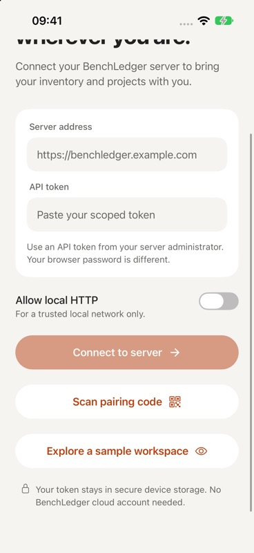
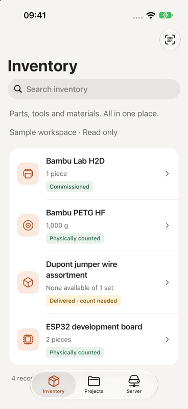
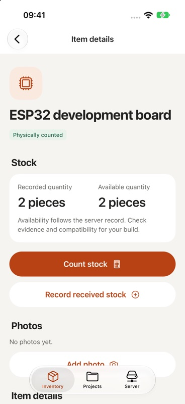
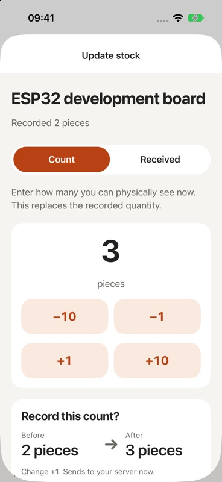
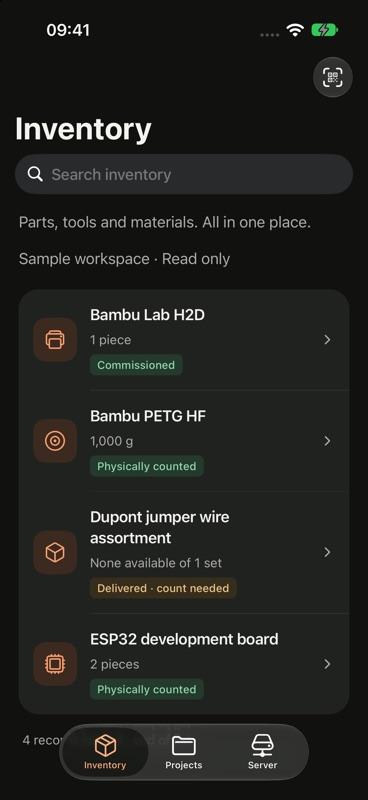

# BenchLedger for iPhone and Android

The native client lives in `apps/mobile`. It uses Expo SDK 57, React Native,
TypeScript and the shared API contracts. Both phone platforms use the same
screens and application client. The web app remains the full desktop workspace.
This is an initial mobile companion, not full web feature parity or an app-store
release. No BenchLedger cloud account or Expo account is required for local use.

**Explore a sample workspace** opens bundled synthetic records without a server,
credentials or network traffic. It is read only and visibly labelled; leave it
from the Server tab before connecting to your own workspace.

| Connect | Sample inventory | Item | Count | Dark |
| --- | --- | --- | --- | --- |
|  |  |  |  |  |

Screenshots: iPhone 17 simulator, iOS 27.0, synthetic sample or demo-server
data. The count screenshot uses the disposable demo server.

## Supported workflows

The iPhone interface targets iOS 27 with native Liquid Glass tabs, large
titles, native search and toolbar actions, inset lists and grouped details.
See the [mobile design system](../apps/mobile/DESIGN.md) and
[design verification record](reviews/2026-09-14-ios27-design.md).

- Connect directly to a user-selected BenchLedger server, including a reverse
  proxy subpath or an address ending in `/api/v1`.
- Store the server address and token in iOS Keychain or Android encrypted
  storage; restore the connection when the app starts and disconnect locally.
  A saved connection opens the workspace immediately and is verified in the
  background. Writes stay disabled until the server confirms the token's scopes.
- Search inventory and projects with automatic paging at the end of the list,
  pull to refresh, inspect evidence, recorded and available quantities,
  locations, project revisions and requirements. Rows show the decision-relevant
  figure, for example `1,000 g` or `Available 3 of 5 pieces`.
- Returning to a screen shows what was already loaded and refreshes it in the
  background ("Updating…"), keeping loaded pages and scroll position. Visible
  screens also refresh when the app returns to the foreground (at most every
  30 seconds). The last good list and detail responses are also saved on the
  device (see [Offline use](#offline-use)), so a cold start without a network
  shows the last synced data.
- Record a physical **count** or **received** stock from an item: large −/+
  steppers, haptic feedback, and an explicit before → after confirmation. The
  change is saved on the phone first and sent in order when the workspace is
  reachable (see [Quick count and receipts](#quick-count-and-receipts)).
- Add a photo to an item's image gallery from the camera or photo library.
  Thumbnails appear in item details and, once a gallery has been opened on
  this phone, in inventory rows.
- Scan an item label (`benchledger://item/<id>`), or a product barcode to search
  inventory; scan the web workspace's pairing QR code to fill in the connect
  form (see [Scanning and labels](#scanning-and-labels)).
- Edit item name, description and location. The form loads the current item
  and sends its version with a stable retry key. If someone else changed the
  item meanwhile (HTTP 409), the app shows the latest server values and offers
  **Keep my changes and retry** or **Discard my changes**. Retrying sends only
  the fields you changed, applied onto the latest record, so fields changed by
  someone else are kept. If both sides changed the same field, the app shows
  both values and you choose which to keep before retrying. These edits do not
  count, consume or commission stock.
- Create a project and its first concept revision atomically, with a stable
  retry key. New projects begin as ideas with an undecided fabrication route.
- Respect read-only and project-scoped tokens. Shared inventory remains
  readable as permitted by the existing API; workspace writes need an unscoped
  write/admin token. Project lists preserve the server's scope filtering.

Use the web workspace for commissioning, project usage and reservations,
procurement, reconciliation, file uploads, CAD viewing and detailed build
planning. The mobile requirements list does not claim stock readiness. There is
no automatic server discovery or printer-control feature.

### Offline use

Responses are cached in a local SQLite database in the app sandbox, scoped to
a SHA-256 digest of the server address and the authenticated account. Another
account on the same server, or another server, never sees that data; connecting
to a different scope deletes the previous one. The API token is never written
there; it stays in iOS Keychain or Android encrypted storage. The account
identifier itself is not stored either, only the digest. At most 300 responses
are kept per scope, oldest first evicted. **Disconnect** deletes the cache, any
unsent stock changes and the authenticated photo cache. An expired token (HTTP
401) deletes the cached responses but keeps unsent stock changes for that
account, so they are sent if the same account reconnects; connecting a
different account discards them.

When the server cannot be reached, screens show the saved data under
**Last synced <time> · offline**. Because the cache is on disk, it may be
included in encrypted device backups.

### Quick count and receipts

From an item, **Count stock** records what you can physically see; it replaces
the recorded quantity and marks the evidence as physically counted (`POST
/inventory/{id}/count`, the same call the web app makes). **Record received
stock** appends a `receipt` stock event (`POST /inventory/{id}/stock-events`),
which adds to the recorded quantity; availability follows the server's
evidence rules. Project usage needs a reservation and stays in the web app.

Each change is written to the phone before any request and keeps one
`Idempotency-Key` for its whole life, so a retry after a timeout is replayed by
the server rather than applied twice (the server scopes the key to the request
fingerprint, which includes the item). Changes replay strictly in the order
recorded when the server is confirmed reachable. Before a change is sent the
first time, the app re-reads the item and compares its `version` with the one
the change was based on; if it moved, the change is held as **needs your
decision** with the latest server quantity, and later changes to that item wait.
You can apply it on top of the latest quantity or discard it. A refusal (for
example a read-only token) is shown as **not accepted** with **Try again** and
**Discard**. Nothing is dropped silently. A change already attempted is resent
with the same key without a version check, because the version may have moved
because of that very change.

The count and stock-event routes do not honour `If-Match`; the version check
is client-side. See [server follow-ups](#known-gaps-and-follow-ups).

### Photos

**Add photo** offers the camera or the system photo picker (no photo-library
permission is needed for the picker). The app downscales to at most 1600 px on
the long edge and recompresses as JPEG, stepping down to 800 px if needed, to
stay under the server's 2 MiB upload limit; re-encoding drops EXIF and GPS
data. Uploads use the existing gallery API with its `expectedVersion` and a
stable `Idempotency-Key`; if the gallery changed meanwhile, the app reloads it
and asks you to try again. Temporary copies are deleted after reading. Images
are fetched with the bearer token and disk-cached by content digest; the cache
is cleared on disconnect. Photo uploads are not queued offline.

### Scanning and labels

The inventory toolbar's **Scan** button opens the camera scanner (QR, Data
Matrix, EAN/UPC, Code 128 and Code 39):

- `benchledger://item/<id>` opens that item; `benchledger://project/<id>` opens
  the project. IDs are validated on the raw text, before any request.
- A pairing code is refused while a workspace is open.
- Any other text, such as a product barcode, fills the inventory search.
- Web addresses are never opened from a scan.

On the connect screen, **Scan pairing code** accepts only a
`benchledger://pair?...` code. It follows the same path as an opened pairing
link: it fills in the form, never connects, never enables local HTTP and is
never logged; the consumed-link hash dedupe applies.

**Printable label format.** Encode the item's ID as the QR payload
`benchledger://item/<id>`, where `<id>` matches `^[A-Za-z0-9][A-Za-z0-9._:-]*$`
(at most 160 characters). Use error correction level M or higher and a quiet
zone of four modules; print the item name under the code for people. The label
carries no server address or token, so it is safe to leave on a drawer, and it
works with whichever workspace the phone is connected to. The web app does not
yet print labels; see the follow-ups.

Camera scanning needs a real device: the iOS Simulator has no camera. The scan
routing is covered by unit tests.

### Offline launch and server health

If the saved server cannot be reached at launch, the app still opens the
workspace with the last synced data and shows **Can't reach your workspace**
with **Retry**. The launch screen stays up until the session restore has chosen
the first screen (at most six seconds). Only a definitive HTTP 401 clears the saved session; timeouts, network
errors and 5xx responses never do. A server reporting `degraded` health is
connected with a visible warning rather than refused.

A server that refuses the address itself is a configuration problem, not an
outage, and is not retried automatically. HTTP 421 (`host_not_allowed`) shows
"This server doesn't accept this address": add the host to
`BENCHLEDGER_ALLOWED_HOSTS` on the server or connect using its public address.
A cross-origin 403 is reported the same way. HTTP 428 asks you to refresh the
record and retry with its current version.

Reads ignore response fields this app does not know, so a newer server can add
fields without breaking the app; quantity invariants and required fields are
still enforced. Before sending the token, the app reads the public
`/api/v1/capabilities` route and refuses a server whose `protocol` is not one
it supports (currently `rest-v1`). Servers without that route are accepted.
`/api/v1/health` exposes only the server's release `version`, which is shown
in the Server tab; it is not used for compatibility decisions.

### Links

The app registers the `benchledger://` scheme:

| Link | Opens |
| --- | --- |
| `benchledger://item/<id>` | An inventory item, above the inventory list |
| `benchledger://project/<id>` | A project, above the project list |
| `benchledger://inventory`, `benchledger://projects`, `benchledger://server` | That tab |
| `benchledger://pair?url=<server>&token=<token>` | Fills in the connect form |

Record links work while a workspace is open (including on a cold start with a
saved connection). Malformed record IDs are rejected before any request. A
pairing link only prefills the server address and token; it never turns on
**Allow local HTTP**, which the user must switch on for an `http://` address.
The user must review and tap **Connect**. Android can report the same launch
link on later cold starts, so the app keeps a SHA-256 hash (never the link or
token) of the last consumed pairing link in secure storage and ignores a
repeat.
It is ignored, with an explanation, while a workspace is already open. The app
never logs a pairing link, but anything that handled it (a QR scanner, chat or
clipboard history) may keep the token, so prefer showing a QR code in person.

## Connect a server

1. Enter the full workspace address, for example
   `https://benchledger.example.com`.
2. Paste a scoped HTTP/API bearer token supplied by the server administrator.
   The workspace's browser password is not an API token. Existing server token
   configuration also works for the mobile HTTP client; see the commented
   `BENCHLEDGER_MCP_READ_TOKEN_HASHES` and `BENCHLEDGER_MCP_WRITE_TOKEN_HASHES`
   fields in [the environment example](../.env.example). The server receives
   the SHA-256 digest in its private configuration; the app receives the
   plaintext token. Do not store either in public source or app configuration.
3. Tap **Connect to server**. The client checks public server identity before sending
   the token, then verifies the authenticated session and scopes.

HTTPS is required for public hosts. **Allow local HTTP** is an explicit opt-in
for local destinations only: RFC1918 IPv4, loopback, IPv4 link-local,
carrier-grade NAT `100.64.0.0/10` (Tailscale addresses), `.local`, `.lan` and
`.home.arpa` names, and IPv6 loopback, link-local (`fe80::/10`) and
unique-local (`fc00::/7`) addresses. Single-label names such as `http://nas`
are not treated as local, because a DNS search domain can resolve them to a
public host; use `nas.lan`, `nas.local`, `nas.home.arpa` or the IP address.
HTTP does not encrypt credentials or workspace data. iOS requests local-network
permission and allows local networking through ATS, with ATS exceptions for
`.lan` and `.home.arpa`. Android permits cleartext at the OS level because its
network security configuration can match hostnames but not IP ranges, and
server hosts are selected at runtime; the app's URL policy restricts HTTP to
consented local destinations. Public hosts still require HTTPS. Use a trusted
certificate; the app never bypasses certificate checks. The wider local-name
and IPv6 coverage is unit-tested; it has not yet been verified on devices.

The phone must be able to reach the server, for example on the same Wi-Fi or
through an already configured VPN. `localhost` on a physical phone is that
phone, not the server. An iOS local-network denial can be changed in Settings.
Use the final server address: HTTP redirects are rejected before following
them, including authenticated requests. Credentials are never put in URLs.

An expired token (HTTP 401) clears the active workspace. Network errors leave
an explicit warning beside any previously loaded information. An unexpected
rendering fault shows **Something went wrong** with **Try again** instead of a
blank app. A disconnect aborts pending
requests, removes the saved connection, and drops all in-memory workspace data.
Keychain entries can survive iOS uninstall; use **Disconnect** before removing
the app if you want to remove the stored token.
Some iOS versions may also offer the system **Save Password?** prompt after
connection despite the field disabling autofill. Choose **Not Now** to keep
the token only in the app's secure storage. Disconnect cannot remove a copy
separately saved in a password manager.

## Develop and validate

Use Node.js 24 and npm 11 from the repository root:

```bash
npm ci
npm run build
npm run mobile
```

The normal build exports both phone bundles. It does not compile or sign native
applications. Native generation and local compilation are separate:

```bash
npm run native:generate --workspace=@benchledger/mobile
npm run ios --workspace=@benchledger/mobile
npm run android --workspace=@benchledger/mobile
```

Local iOS builds need a compatible Xcode and CocoaPods. Android needs the
Android SDK and JDK. SDK 57 targets iOS 16.4+ and Android 7+; use the current
[Expo compatibility table](https://docs.expo.dev/versions/latest/) when updating.
Use a native development/release build for the iPhone navigation; Expo Go is
not the validation target for the native-tabs API. iOS 27 is the design target;
the deployment minimum still allows earlier supported systems to render their
own native navigation. Exact iOS 27 appearance needs Xcode 27/iOS 27 validation.
Generated `ios`, `android` and `.expo` directories stay out of Git and Docker.
Public-source scanners omit them only when none of those paths is tracked.
The server Docker image excludes the mobile workspace and installs only its
server/web/package workspaces; `build:server` keeps native bundling out of that
image build.

After a server build, a disposable loopback-only demo can exercise the iPhone
simulator without touching a real workspace:

```bash
npm run mobile:demo
```

Use `http://127.0.0.1:8796`, enable local HTTP, and enter the printed synthetic
token. Set `BENCHLEDGER_MOBILE_DEMO_PORT` to use another loopback port. The
data lives only in memory and disappears when that process stops. An Android
emulator normally reaches host loopback through `10.0.2.2`.

iOS 27 requires the UIScene life cycle. The `plugins/with-scene-lifecycle.cjs`
config plugin adopts Expo's `ExpoAppSceneDelegate` during native generation
until the Expo prebuild template does so itself. If CocoaPods fails with a
Unicode normalisation error, run native generation with `LANG=en_US.UTF-8`.

Android debug builds need JDK 17 and the Android SDK (platform 36, build tools
36, NDK 27.1). CI runs `expo prebuild --platform android` and
`./gradlew assembleDebug` in the `mobile` workflow on mobile changes. Locally:

```bash
cd apps/mobile && npx expo prebuild --platform android
cd android && JAVA_HOME=<jdk17> ANDROID_HOME=<sdk> ./gradlew assembleDebug
```

`scripts/adaptive-icon.py` derives the Android adaptive-icon foreground from
`assets/icon.png` (no new artwork); rerun it if the icon changes.

```bash
npx vitest run apps/mobile/src
npm run typecheck --workspace=@benchledger/mobile
npm run mobile:export
npm run public:check
npm run check
```

The mobile tests run in Vitest without a simulator. They cover the API client
against the real Fastify application with synthetic records (including counts,
receipts, idempotent retries and gallery uploads), forward-compatible reads,
the local-address policy, quantity presentation, the connect/restore/
offline/401 session controller with persistent scopes, the SQLite cache (via
Node's built-in SQLite) and its scoping and wipe, the stock queue's ordering,
idempotency, conflicts and restart recovery, scan routing, photo downscale
decisions, pairing and record links, stale-while-revalidate loading and paging,
the edit-conflict flow, foreground throttling and the error boundary. Screen components themselves (`screens.tsx`, `App.tsx`) are not
rendered in tests; their logic is extracted into the tested modules. Native
builds and screenshots are distinct from these tests and from physical-device
or store verification.

Changes to `app.json` (background colour, Android adaptive icon, ATS exception
domains) and to the config plugin take effect only after native regeneration
(`native:generate`) and a rebuild.
See the [initial implementation and verification record](reviews/2026-09-14-native-mobile.md)
for the tested platforms, screenshots and remaining release checks.

## Known gaps and follow-ups

- Server: `POST /inventory/{id}/count` and `/stock-events` ignore `If-Match`, so
  the stale-version check for queued stock changes is client-side and cannot be
  atomic. Honouring an optional `If-Match` there would close that window.
- Server: inventory list rows carry no primary image reference, so row
  thumbnails appear only for items whose gallery was opened on this phone.
- Web: printing item labels (QR `benchledger://item/<id>`) is not implemented.
- Barcode scanning has not been exercised on a physical device.
- Photo uploads are not queued offline; stock changes are.
- The space above iOS large titles is UIKit's navigation bar row: on the iOS 27
  simulator the title sits at the same position as the system Settings app, so
  it was left native. On Inventory that row now holds the **Scan** button.
- The Android adaptive icon and splash have only been checked as generated
  resources, not on a device or emulator.

## Architecture and dependency decisions

Expo provides native controls and one mobile codebase. Native modules added
for offline use and the bench workflows are all Expo SDK 57 packages:
`expo-sqlite`, `expo-haptics`, `expo-camera` (barcode scanning),
`expo-image`, `expo-image-picker`, `expo-image-manipulator`,
`expo-file-system` (temporary file clean-up) and `expo-splash-screen`. Capacitor would reuse
the DOM UI but render screens in a WebView; Swift and Kotlin would create two
separate clients. Server business rules remain in the shared application layer.
There is no new server route, migration or authentication mode.

React 19.2.8 is shared with the web app, within React Native 0.86.3's declared
peer range. Expo's checker expects exactly 19.2.3 and reports that patch
difference. Keep the discrepancy visible; do not suppress the check or
downgrade the existing web dependency just to silence it.

Two targeted dependency overrides avoid known vulnerable transitive versions:
`xcode` uses UUID 11.1.1 (its required `v4()` API is unchanged), and React
Navigation uses query-string 9.5.1. A small Metro adapter exposes that parser's
named API for React Navigation 7. Parser compatibility has a focused test.
Recheck these overrides when upgrading Expo or React Navigation. The
root also declares their parent packages as build/test dependencies so npm 11
applies the overrides consistently across workspaces. The
[third-party notices](third-party-notices.md) record the BSD licence choice for
node-forge in Expo's build tooling.

## Release and rollback

The first internal TestFlight build was `0.1.0 (1)`. The App Store preparation
targets version `1.0.0`, build `2`; the workspace `package.json` version
matches `expo.version`; increment
`expo.ios.buildNumber` before uploading a subsequent build. The bundle identifier
is `app.benchledger.mobile`. Native generation carries the version and build
number into the generated Xcode project.

TestFlight distribution requires an Apple developer team, an App Store Connect
app entry, a distribution-signed export and a processed build assigned to a
tester group. Supply team and signing configuration outside public source.
An archive or successful JavaScript export alone is not a TestFlight release.
See the [first TestFlight release attempt](reviews/2026-09-14-testflight.md)
for verified progress and remaining account-access blockers. Physical-device
and exact iOS 27 validation remain outstanding.

No EAS project, cloud build or over-the-air update channel is created by these
scripts. TestFlight approval does not authorise a public App Store release or a
server deployment.

The mobile client can be removed from a device without migrating or rolling
back the server. Local disconnect does not revoke a server token; an
administrator manages token revocation on the server separately.

See [CLI releases](mobile-release.md) and the [mobile privacy policy](mobile-privacy.md).
