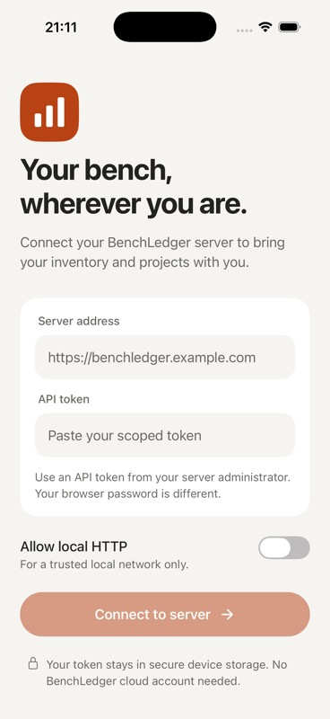
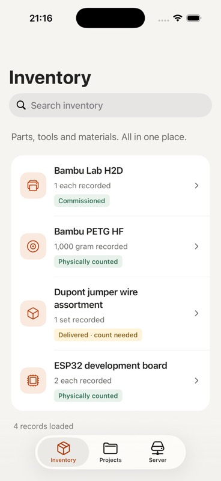
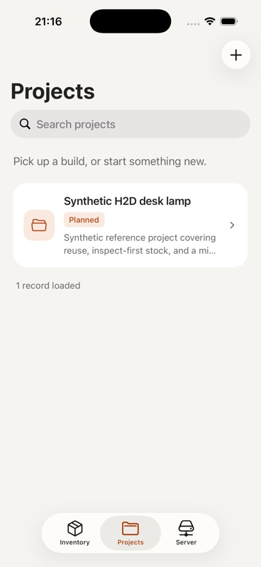
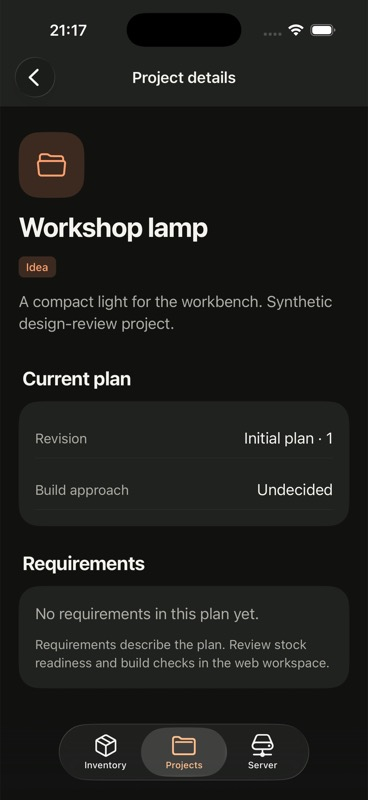
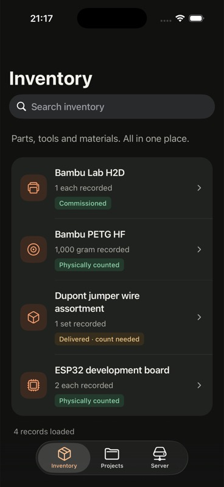
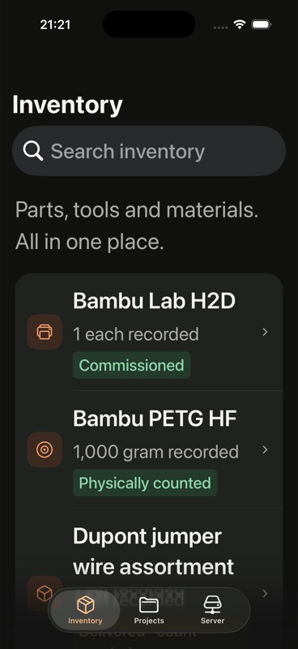

# iOS 27 design pass — 14 September 2026

This replaces the initial phone styling with an iOS 27 design direction.
Apple confirms the release date on its [iOS page](https://www.apple.com/os/ios/).
The implementation follows the current [WWDC26 design guidance](https://developer.apple.com/wwdc26/guides/design/)
and the [mobile design system](../../apps/mobile/DESIGN.md).

## Changes

- Native UIKit tabs with system Liquid Glass and SF Symbols on iPhone.
- Native large titles, always-visible stacked search and a native toolbar
  action for project creation.
- Warm neutral content surfaces, inset inventory/project lists, recognisable
  item icons and clearer grouped details, forms and server settings.
- Light/dark colours, readable evidence labels and explicit screen-reader
  labels that exclude decorative icon-font glyphs.
- Live Dynamic Type changes remeasure scroll content. Searches, draft values
  and fetched data remain in the owning screen; changing text size can reset
  scroll position. Quantity and fact layouts stack at larger text sizes.
- Android retains its existing tab navigation and inline search while sharing
  the content design. No new dependency, authentication mode or server API.

## Screenshots

These are actual captures of the running release build on the available
iPhone simulator, **iOS 26.5**. They show the implemented design and native
material on that runtime; they do not establish the exact iOS 27 rendering.
All records come from a disposable synthetic server.

| Connection | Inventory | Projects |
| --- | --- | --- |
|  |  |  |

| Project details, dark | Inventory, dark | Accessibility text size |
| --- | --- | --- |
|  |  |  |

## Verification

Native release builds passed using Xcode 26.6 and an iPhone 17 Pro simulator.
The native checks covered connection restoration, tab switching, searching
inventory and clearing the search, project creation through the new toolbar,
the returned project/revision, dark appearance and live changes from default
to accessibility-medium text size. The initial native inspection found and
fixed hidden large titles, decorative glyphs in row labels and stale row
heights after Dynamic Type changes.

The full repository gate passed: 120 test files, 1,046 tests and 130 browser
tests. This includes two new regressions for spoken inventory labels and
unit-correction precedence. Global 80% coverage thresholds remain in force.
Both production phone bundles, mobile typechecking and public-source checks
also passed. The final Dynamic Type correction was rebuilt and exercised
natively, including a live text-size change while a search remained active.
`npm run check` then passed again on the final implementation: 1,046 tests and
130 browser tests. Coverage was 89.57% statements/lines, 82.19% branches and
81.95% functions.

All eight checked text/background colour pairs in each theme exceed 4.5:1;
the minimum is 4.65:1 in light mode and 6.85:1 in dark mode. These measurements
cover the authored opaque content colours, not the OS-rendered glass material.

The design review was performed inline because no independent subagent
reviewer was available. The screenshot review confirmed the listed visual
fixes; it is not an accessibility certification. UIKit controls manage their
own appearance and motion; content adds no custom entrance animations.

## Release boundary

**iOS 27 is the design target. Xcode 27 and an iOS 27 runtime/device are still
required to verify that release's exact appearance and compatibility.** The
local toolchain and simulator were not upgraded during this design pass.
Android native/device validation and store distribution remain outstanding.
The existing Expo/React patch discrepancy and optional iOS password-saving
prompt are documented in [mobile setup](../mobile-app.md).

No production workspace was used. No source was committed or published, and
no server or app-store release was performed. The demo connection was removed,
the original light/default-text preferences restored, and the task's server
and simulator stopped.
