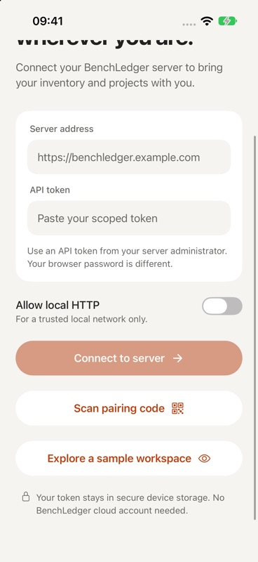
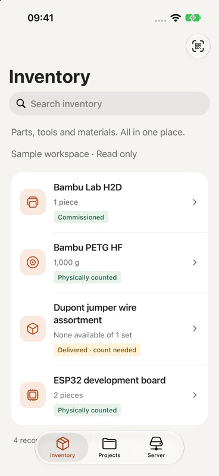
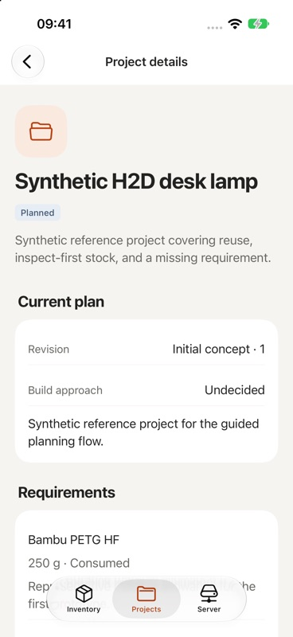
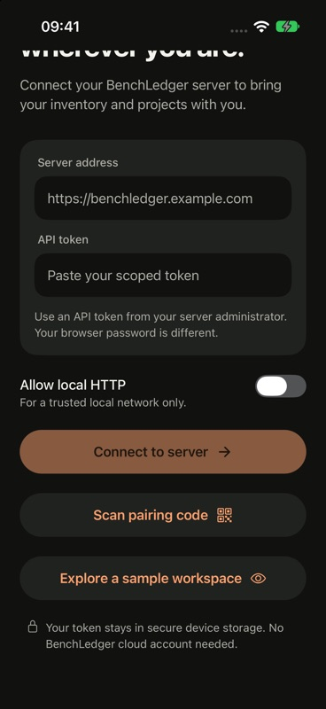

# Native mobile implementation — 14 September 2026

The later [iOS 27 design pass](2026-09-14-ios27-design.md) supersedes the
screenshots below. This record preserves the initial implementation checks.

The initial Expo client supports iPhone and Android from one TypeScript
workspace, `apps/mobile`. It connects directly to an existing BenchLedger
server using a scoped API token. See [setup and supported workflows](../mobile-app.md).

## Delivered locally

Connection and secure credential restoration, inventory and project search,
pagination and refresh, item evidence/details, project requirements, optimistic
item metadata edits and atomic project creation are implemented. Read-only
and project-scoped permissions come from the existing server API. No server
endpoint, authentication change, migration or remote deployment was needed.

The public source uses synthetic fixtures. Generated native projects are
untracked build products. The server Docker context excludes the mobile
workspace; its install/build/prune path was verified separately without Expo.
The Docker image itself was not built or deployed during this work.

## Verification

| Check | Result |
| --- | --- |
| Node 24 / npm 11 lockfile install | `npm ci` passed |
| Required repository gate | `npm run check` passed |
| Unit and integration suite | 119 files, 1,044 tests passed, including 40 mobile tests |
| Browser regressions | 130 Playwright tests passed |
| Global coverage | Statements/lines 89.57%, branches 82.18%, functions 81.94%; 80% thresholds retained |
| Production JavaScript | iOS and Android Expo exports passed |
| Native iPhone | Release build installed and launched in an iPhone 17 Pro simulator on iOS 26.5 using Xcode 26.6 |
| Native workflows | Connected to a disposable loopback server, read inventory, saved and reread an item location, created and reread a project with its first revision, disconnected and returned to an empty connection form |
| Appearance | Light, dark and one larger preferred-text setting inspected in Simulator |
| Production dependencies | `npm audit --omit=dev`: zero vulnerabilities |
| Expo doctor | 20/21 checks; React patch-version mismatch recorded below |
| Server isolation | Selected workspace install, server build and production prune passed without an installed Expo/mobile workspace |

The full dependency audit still reports three moderate development-tool
advisories in the existing Vitest/mocker chain. Existing package versions were
preserved; test-toolchain upgrades are outside this change. The final source
diff and public checks were reviewed again after documentation was added.

Screens were reviewed inline against the existing BenchLedger palette,
native navigation, evidence wording, form states and readable text. This was
not an independent design review or a full accessibility certification.

## Native screenshots

Captured from the running app with synthetic records. These are simulator
screenshots, not design mockups or evidence of physical-device validation.

| Connection | Inventory | Project | Dark appearance |
| --- | --- | --- | --- |
|  |  |  |  |

## Remaining release work

- Android native compilation and emulator/device checks: this host has no
  Android SDK or Java runtime. The Android JavaScript export passed.
- Expo expects React 19.2.3; the existing shared React 19.2.8 satisfies React
  Native's peer range and passed the native iPhone run. The doctor discrepancy
  remains visible and needs reassessment when dependencies are upgraded.
- iOS 26.5 can show an optional system password-saving prompt despite the API
  token field disabling autofill. It was declined during testing; the app's
  own credential storage and disconnect worked. A separately saved password
  manager copy is outside the app's disconnect operation.
- Physical iPhone/Android checks, LAN permission behaviour on actual devices,
  distribution identities, signing, store metadata and privacy declarations.
- Broader accessibility/device-size checks before distribution. Initial
  testing does not establish full web feature parity or offline operation.

No commit, push, pull request, cloud build, store submission, production
connection or deployment was performed. There is no server rollback or data
migration required by this client; uninstalling the app leaves server state
unchanged. Disconnect first to remove its locally saved token.
